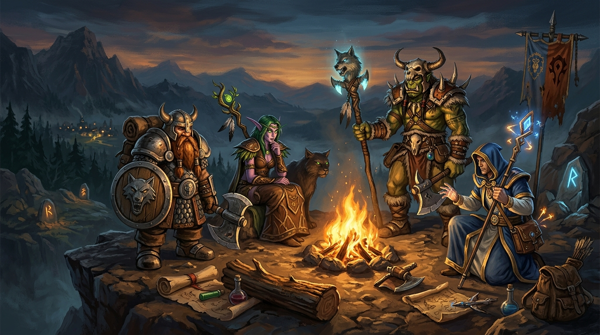
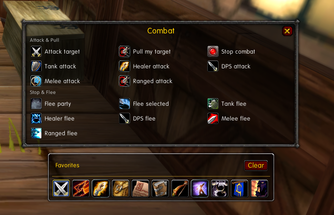

<div align="center">



# Warband

[]()
[](https://turtlecraft.gg/)
[]()
[](LICENSE)

An intuitive, graphical command panel for World of Warcraft servers running the TortoiseBots engine and vMaNGOS.

[Overview](#overview) • [Features](#features) • [Commands Guide](#commands-guide) • [Installation](#installation) • [Usage](#usage) • [Compatibility](#compatibility) • [Credits](#credits)

</div>

---

## Overview

**Warband** is an in-game graphical control suite built for the **Turtle WoW (1.18.1.7272)** and **Vanilla (1.12.1)** clients. It provides a visual management center to operate your playerbots without typing repetitive console commands: summon and log in characters, invite them into parties or raids, manage combat tactics, assign strategies, inspect bot inventories, cast spells, vendor trash, repair gear, and distribute loot.

<div align="center">



</div>

---

## Features

- **Primary Command Bar**: Ten categorized tactical groups spanning 182 comprehensive actions (Combat, Movement, Spacing, Formations, Stances, RTI Targets, Utility, Gearing, and Maintenance). Clicking any category opens a dedicated window. Selecting another category reuses the existing frame to eliminate UI clutter.
- **Persistent Favorites Strip**: Right-click any command button across the panel to pin it to your persistent Favorites bar directly above the main panel.
- **Player Roster & Auto-Fill**:
  - Live character roster supporting both account alts (`.bot roster` via TBM protocol) and active world instances (`.bot list`).
  - Real-time search filter with instant character lookup and quick `+ Add` registration.
  - One-click friendly target addition (`+ Target`).
  - Dual-action party invitation pipeline executing native client packets (`InviteByName`) and TortoiseBots engine commands (`.bot invite`) with asynchronous spawn watchers and automatic raid conversion.
  - One-click party (`Fill group`) and raid (`Fill raid`) deployment.
- **Strategy & Behavior Management**: Dynamically queries the bot's supported strategies from the server engine, offering category toggles (`+`, `-`, `~`) for combat, non-combat, and reaction states.
- **Spells & Buffs**: Visual ability catalog categorized by spell family (Auras, Blessings, Shouts, Aspects, Seals, Totems) with one-click group rebuffing.
- **Inventory & Bags**: Visual item grid with authentic quality borders, item upgrade flags, and direct Equip, Use, Trade, and Sell interactions.
- **Role Assignment**: Rapid class-based role bar. Left-click assigns primary roles (Tank / Healer) and right-click assigns secondary roles (DPS) across all group bots simultaneously.
- **Minimap Quick-Toggle**: Draggable 360-degree minimap button with live tooltip information.

---

## Commands Guide

For the exhaustive reference covering all 182 actions, command IDs, dispatch scopes (Say, Whisper, Party, Target), and native TortoiseBots syntax, refer to the complete tactical manual:

- [**Warband Commands & Tactical Manual**](docs/COMMANDS_GUIDE.md)

---

## Installation

1. Download or clone this repository.
2. Copy the `Warband` directory into your World of Warcraft directory under:
   ```text
   Interface\AddOns\Warband
   ```
3. Ensure the folder name inside `AddOns` is named exactly `Warband` (containing `Warband.toc`, `Core.lua`, etc.).
4. Restart your game client or reload the UI with `/console reloadui`.

---

## Usage

Use `/warband` or `/unbot` to toggle the primary command bar.

### Shortcut Commands

| Slash Command | Window / Action |
|:---|:---|
| `/warband roster` | Toggle Account & World Bot Roster |
| `/warband strategy` | Toggle Strategy & Behavior Editor for targeted bot |
| `/warband spells` | Toggle Spellbook & Buffs panel for targeted bot |
| `/warband bags` | Toggle Inventory & Bag viewer for targeted bot |
| `/warband fill` | Automatically fill open 5-man party slots with available bots |
| `/warband fillraid` | Convert group to raid and fill open raid slots up to 40 |

### Diagnostic Commands

- `/warband debug`: Toggle internal debug message output.
- `/warband checkapi`: Audit client API availability and environment flags.
- `/warband capture`: Toggle server chat packet inspection.

---

## Compatibility

### Client Environment (Turtle WoW 1.18.1 vs Vanilla 1.12.1)

- **Item Textures**: Seamlessly handles Turtle WoW's extended `GetItemInfo` signature (returning textures at index 9) with graceful fallback to standard 1.12 indices and AtlasLoot caches on vanilla clients.
- **Lua 5.0 Compliance**: Crafted strictly for the classic Lua 5.0 engine (`table.getn`, `string.find`, `string.gsub`, global frame references `this`, `event`, `arg1`).
- **Safe Queue Throttle**: Centralized command pump (`QUEUE_DELAY = 0.4s`) with frame-safe elapsed calculations prevents client-side chat flooding and disconnects when dispatching bulk orders.

### Server Engine Integration

Engineered specifically for **TortoiseBots** on **Turtle WoW vMaNGOS** (client 1.18.1.7272). Supports the structured `TBM:` protocol lines (`TBM:ROSTER_BEGIN`, `TBM:ROSTER`, `TBM:ROSTER_END`, `TBM:ALTBOTS`) while maintaining full backwards compatibility with legacy `mangosbot` syntax (`.bot list`, `.bot add`, `.bot remove`).

---

## Credits

- Originally rewritten for 1.12 based on the concepts from the 3.3.5 addon **UnBot**.
- Modernized, audited, and maintained for **Turtle WoW Classic+ (1.18.1)** and the **TortoiseBots** ecosystem.
