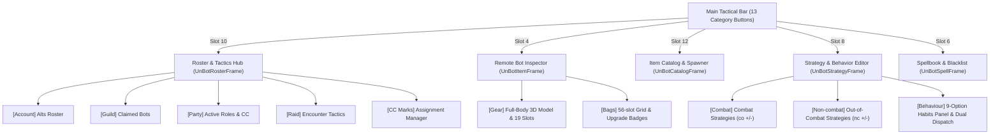

# Retinue Architecture & System Specifications

**Retinue** is an in-game graphical companion control suite targeting the **Turtle WoW 1.18.1 client (Interface 11200 / Vanilla Lua 5.0)** powered by the **TortoiseBots** engine and **vMaNGOS**.

---

## 1. System Overview

Retinue is structured around a non-intrusive, event-driven client architecture. All commands travel over the quiet addon message channel (`SendAddonMessage("TBM", ...)`) or fallback chat commands, while server state is parsed from structured `TBM:` streams.



---

## 2. File Organization & Responsibilities

| File | Purpose & Responsibilities |
| :--- | :--- |
| **`Core.lua`** | Addon initialization (`Init`), slash commands (`/retinue`, `/ret`, `/rtn`, `/wb`), draggable window positioning, transport negotiation (`TBM:TRANSPORT`), quiet dispatching (`SendBotCommand`), and protocol routing (`TBM:BOTSTATE`, `TBM:INV_*`). |
| **`Data.lua`** | Command IDs, protocol tokens, constants (`Retinue.C`), equipment slot definitions (`GEAR_LEFT`, `GEAR_RIGHT`, `GEAR_BOTTOM`), universal `CLASS_ICON_TCOORDS` / `CLASS_COLOR`, and combat role policy (`Retinue.Roles`). |
| **`Localization.lua`** | English string tables (`UnBotL.TITLE`, `UnBotL.HELP`, `UnBotL.ROSTER`, `UnBotL.INSPECT`) and keybindings. |
| **`Roster.lua`** | Multi-Tab Roster & Tactics Hub (`UnBotRosterFrame`): Account alts, Claimed wandering guild bots, Active party view, Raid encounter tactics, CC marks manager, and sequenced batch invite queue (`QueueRosterBatch`). Click-to-interact targeting for all bots. |
| **`Items.lua`** | Remote Bot Inspector (`UnBotItemFrame`): 3D `PlayerModel` paperdoll with full-body scaling (0.70) and interactive mouse rotation/zoom, 19 equipment slots, 56-slot bag grid with upgrade markers (`+`), trade automation ("Give to me" & "Trade"). |
| **`Actions.lua`** | Tactical action modals, persistent 10-slot favorites drawer, Pull/Pullback delay steppers, and real-time party consensus switch lamps (AoE, Auto CC, Loot). |
| **`Commands.lua`** | Handlers for raid commands (Tankface, Douse, Custom tactics on/off/status, Raid boss status), guild release, and pull steppers. |
| **`Catalog.lua` & `CatalogData.lua`** | 26k+ authentic Turtle WoW item database, multi-slot filtering, name search, and 1-click spawning. |
| **`Strategy.lua`** | Real-time AI combat (`co`), non-combat (`nc`), and dedicated Behaviour options panel (`f.behaviorPanel`) with dual-dispatch command engine (`.bot behavior` & whisper strategies). |
| **`Spells.lua`** | Remote companion spellbook inspection and encounter blacklisting (`nc -<spell>`). |
| **`UI.lua`** | Construction and rendering of the main 13-slot tactical bar and 360° minimap tracking button. |

---

## 3. Protocol Wire Specifications (`TBM` Prefix)

Retinue communicates with `Sagiroth/TortoiseBots` over `SendAddonMessage("TBM", cmd, "PARTY")` when in a group, or via `SendChatMessage(".bot " .. cmd, "SAY")`. The server responds with structured protocol streams:

### A. Addon Transport & Capabilities
- `TBM:TRANSPORT|<party|none>`: Advertises whether the server supports silent addon channel messages.
- `TBM:CAPS|<cap1>,<cap2>|...`: Advertises supported features (e.g. `pull-seconds`).
- `TBM:VERSION|<version>`: Reports server module version.

### B. Claimed Guild Bots Stream
- `TBM:CLAIMED_BEGIN|<expectedCount>`
- `TBM:CLAIMED|<guid>|<name>|<classId>|<level>|<serverState>|<gearLocked>|<location>|<role>`
- `TBM:CLAIMED_END`

### C. Crowd Control (CC) Assignment Stream
- `TBM:CC_ASSIGN_BEGIN|<expectedCount>`
- `TBM:CC_ASSIGN|<name>|<mark>`
- `TBM:CC_ASSIGN_END`

### D. Inventory & Paperdoll Stream (Canonical Server Protocol)
- `TBM:INV_BEGIN|<botName>|<copper>`: Initializes inventory session and reports bot gold.
- `TBM:INV_EQ|<slot>|<itemId>|<durability>|<maxDurability>`: Maps equipped items across 19 equipment slots (0..18).
- `TBM:INV_ITEM|<bag>|<slot>|<itemId>|<count>|<flags>`: Carried inventory items. Flags: `e` = equippable, `u` = upgrade, `b` = soulbound/no-trade, `-` = none.
- `TBM:INV_END|<botName>|<freeSlots>|<totalSlots>`: Commits snapshot, updates bag free/total slots, and triggers UI refresh.
- **Cache Query Engine (`requestItem`)**: Queries uncached item links via hidden `UnBotScanTip:SetHyperlink("item:" .. id .. ":0:0:0")` and listens for `GET_ITEM_INFO_RECEIVED`.
- **3D PlayerModel Resilient Fallback**: Renders live `PlayerModel:SetUnit(unit)` when bot is within visual radius; cleanly hides model and displays distance notice `"(3D model requires bot in visual range)\nEquipped gear & bags are fully accessible."` when distant or offline, keeping all slots interactive.

### E. Bot State & Behavior Stream
- `TBM:BOTSTATE|<name>|<move>|<aoe>|<autocc>|<loot>|<savemana>|<boost>|<threat>|<potions>`

---

## 4. Roster Hub Architecture (`Roster.lua`)

`UnBotRosterFrame` is an integrated 500×430 modal window providing 5 dedicated operational tabs:

1. **`[Account]` Tab**:
   - Manages player-owned account alts.
   - Real-time search query and class filter buttons.
   - Bulk actions: `Fill group (5)`, `Fill raid (40)`, `Log out filtered`, `Add friends`, `Uninvite`, `Log out`, `Delete`, `Clear`, `Sync`.
   - Driven by `QueueRosterBatch` to prevent race conditions during multi-bot logins and invites.
2. **`[Guild]` Tab**:
   - Manages wandering bots claimed into the guild via `/ginvite <BotName>`.
   - Displays Name, Level, Class, and Gear Badge:
     - `[Locked]` in gold for level 60 bots (server never self-equips or vendors).
     - `[Leveling]` in green for 1–59 bots (bot equips world upgrades).
   - Backpack button opening that bot's remote inspector.
   - Role cycler button invoking `.bot role <bot> <role>`.
   - Release button (`Rel`) prompting confirmation dialog before executing `/gkick <BotName>` to return bot to the wandering pool.
   - Multi-select checkboxes with `Invite to Raid` and `Summon to Raid`.
3. **`[Party]` Tab**:
   - Dedicated 5-member live group overview.
   - Player Master row: set player role (Tank, Healer, DPS) via `.bot role self <role>`.
   - 4 Party bot rows: live status description, tailored role buttons, CC mark icon indicator, and backpack inspect button.
   - Click-to-target functionality.
4. **`[Raid]` Tab**:
   - Active when in a raid group (`UnitInRaid("player")`).
   - Encounter Helpers: `Tank face away` (`.bot action raid tankface`), `Douse runes` (`.bot action raid douse` for Molten Core).
   - Turtle Custom Raids: `Custom tactics: on/off` toggle button with consensus lamp for Emerald Sanctum, Lower Karazhan, and Karazhan Crypt.
   - Bot Boss Tactics: `Check bots` (`raid status`) queries and displays active boss tactic modules per bot.
5. **`[CC Marks]` Tab**:
   - Displays 8 raid target marks (Star to Skull).
   - Displays assigned bot owner in class color.
   - `Next` button assigning mark to next online bot (`cc <mark> <Bot>`).
   - `X` button clearing mark owner (`cc clear <Owner>`).
   - `Clear all` button (`cc clear`).
6. **Class Filter Strip & Visual Accent Rows (TortoiseBotsManager Parity)**:
   - Universal `CLASS_ICON_TCOORDS` defines authentic 256x256 UV mapping for `Interface\Glues\CharacterCreate\UI-CharacterCreate-Classes`.
   - `UnBot:CreateClassFilters` creates an "ALL" button and 9 class filter buttons with hover tooltips and selection highlight textures.
   - Every roster row in `CreateRosterRows` and `CreateGuildView` contains:
     - 3px vertical class-colored left accent line (`row.accent`) matching TortoiseBotsManager styling.
     - 16x16 class icon (`row.classIcon`) clipped via `UnBot:GetClassCoords()`.
     - Name text colored by class color via `UnBot:GetClassColor()`.
   - `GetFilteredRoster()` matches classes by canonical uppercase token (`UnBot:GetClassToken()`), making search and filtering completely invariant to numeric IDs or string capitalization.
7. **Universal Bot Targeting & Multi-View Click-to-Interact Pipeline**:
   - `UnBot:TargetBot(name)` resolves `GetGroupUnit(name)` and calls `TargetUnit(groupUnit)` for grouped bots (immediate targeting across any distance without render limits), with `TargetByName(name, true)` fallback for nearby rendered bots.
   - All roster rows across all tabs (`CreateRosterRows`, `CreateGuildView`, `CreatePartyView`) are interactive `Button` widgets with highlight textures (`UI-QuestTitleHighlight`), `LeftButtonUp` and `RightButtonUp` click registration, and tooltips.
   - `UnBot:InteractWithBot(name, button)` unifies targeting, Shift-click (remote inspector), Right-click (uninvite / release / logout), and Left-click (spawning offline alts + group invite).
   - In `UnBot:InviteBot(name)`, native group invite (`NativeInvite(name)` / `InviteByName(name)`) is used universally, and `.bot invite <name>` is dispatched only if `data and data.altbot == true`, completely preventing "same account only" server rejections on non-account, wandering, or claimed guild bots.
   - In `CreateCCView`, mark owners are clickable buttons that instantly target the assigned bot via `UnBot:TargetBot`.

---

## 5. Remote Bot Inspector Architecture (`Items.lua`)

`UnBotItemFrame` (520×470) provides full remote inspection and management for the selected bot:

1. **`[Gear & Paperdoll]` Tab**:
   - Centered 3D `PlayerModel` rendering the bot's live 3D appearance, race, and gear.
   - 19 Equipment Slots (`GEAR_LEFT`, `GEAR_RIGHT`, `GEAR_BOTTOM`) with slot borders, item textures, and hyperlink tooltips.
   - Left-click slot: unequip gear to bot bags.
   - Durability bar and bot money display (Gold, Silver, Copper).
2. **`[Bags Inventory]` Tab**:
   - 56-slot Grid (7 rows × 8 cols) displaying bot inventory.
   - Authentic quality borders (Poor to Legendary).
   - Upgrade detection marker (green `+` badge) on items that are detected upgrades.
   - Left-click: opens Action Menu (`Equip`, `Give to me`).
   - "Give to me" trade automation: initiates trade window and automatically transfers item into trade slot.
   - "Trade" button: initiates direct player trade (bot automatically accepts).
   - "Catalog" button: opens Retinue's 26k+ Item Catalog & Spawner.
3. **`[Behaviour]` Tab**:
   - Real-time switches for `Loot corpses`, `AoE spells`, `Auto CC`, `Save mana`, `Cooldowns`, `Watch threat`, and `Drink potions`.
   - Status lamps (green = On, red = Off) synced directly with server engine state.

---

## 6. Global Table Bootstrapping & Load-Order Invariants

To guarantee 100% crash immunity across all WoW 1.12.1 / Turtle WoW 1.18.1 client environments:

1. **Defensive Namespace Declaration**:
   - Every `.lua` file begins with:
     ```lua
     Retinue = Retinue or {}
     retinue = Retinue
     UnBot = Retinue
     ```
   - This ensures case-insensitivity (`retinue` vs `Retinue`), backwards compatibility (`UnBot`), and eliminates `attempt to index global retinue a nil value` regardless of file load order.
2. **Table Preservation in `Core.lua`**:
   - `Core.lua` uses `Retinue = Retinue or {}` rather than empty literal `Retinue = {}`. This prevents overwriting sub-tables (`Retinue.C`, `Retinue.Roles`) initialized by earlier files.
3. **Sequential TOC Load Order**:
   - `Core.lua` is sequenced immediately after `Localization.lua` in `Retinue.toc` before data tables and UI windows.
4. **Defensive Sub-Namespace Guards**:
   - Access to dynamic sub-tables is wrapped with nil guards:
     ```lua
     local role = (Retinue and Retinue.Roles and Retinue.Roles.GetBotRole and Retinue.Roles.GetBotRole(name, class)) or "dps"
     ```
5. **Sub-Module Lifecycle Initialization**:
   - `Core.lua:Init()` calls `self:InitRoster()`, `self:InitItemEvents()`, `self:InitSpellEvents()`, and `self:InitUI()`, each wrapped in defensive existence guards (`if self.Init* then self:Init*() end`).
   - `Items.lua` implements `UnBot:InitItemEvents()` and `UnBot:ReceiveItemWhisper(msg, sender)`, registering `CHAT_MSG_WHISPER` and `CHAT_MSG_ADDON` for remote inspection queries.
